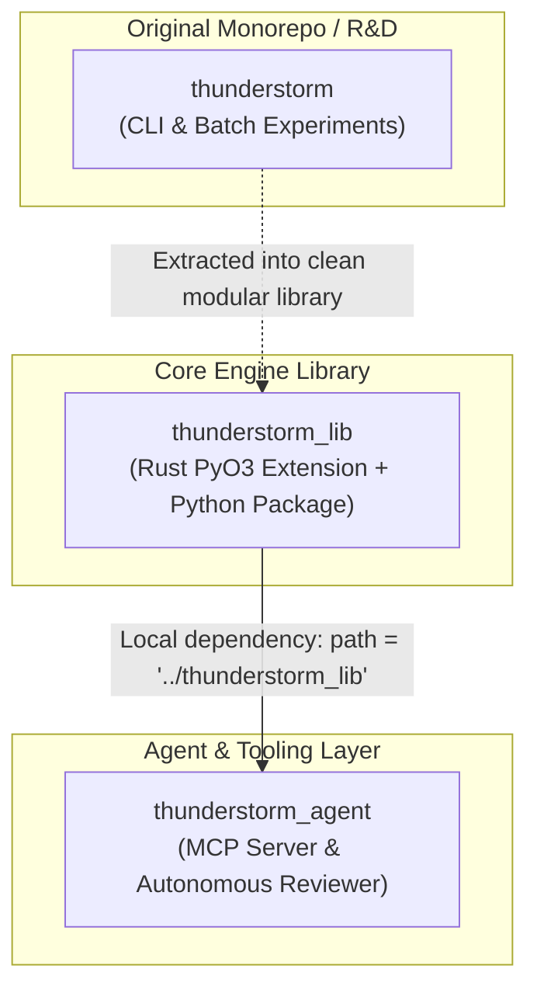

# Overview: Thunderstorm Ecosystem Repositories

This document provides a architectural overview and reference mapping for the three related **Thunderstorm** repositories located in `~/03.projects/`:
- [`~/03.projects/thunderstorm`](file:///home/chris/03.projects/thunderstorm)
- [`~/03.projects/thunderstorm_lib`](file:///home/chris/03.projects/thunderstorm_lib)
- [`~/03.projects/thunderstorm_agent`](file:///home/chris/03.projects/thunderstorm_agent)

---

## 1. High-Level Architecture & Relationships

### Relationship Summary
1. **`thunderstorm` (Original Prototype / CLI Runner)**: The initial exploration and development repository. Contains the core algorithm prototypes, Hydra configuration system, batch evaluation scripts, and performance benchmark logs.
2. **`thunderstorm_lib` (Packaged Core Library)**: The refactored and modularized library version of Thunderstorm. Combines high-performance Rust graph traversal extensions (via PyO3) with a clean Python API (`agent_api.py`, `pipeline.py`, `update.py`), packaged with Maturin.
3. **`thunderstorm_agent` (MCP Server & AI Agent Runtime)**: An application layer that exposes `thunderstorm_lib` capabilities over the Model Context Protocol (MCP). Enables AI agents to interactively analyze SNOMED CT refsets, tune hyperparameters, interrogate the ontology graph, and persist structured clinical reviews.

---

## 2. Repository Details & Folder References

### 2.1 [`thunderstorm`](file:///home/chris/03.projects/thunderstorm) (R&D and CLI)

* **Location**: `/home/chris/03.projects/thunderstorm`
* **Purpose**: Experimental workbench for developing the 6-phase reverse-engineering algorithm that converts flat SNOMED CT refset codes (such as primary care disease clusters) into intensional Expression Constraint Language (ECL) expressions.
* **Key Folders & Files**:
  * [`main.py`](file:///home/chris/03.projects/thunderstorm/main.py): CLI entry point run via Hydra (e.g., `python main.py cluster=AST_COD`).
  * [`src/engine.py`](file:///home/chris/03.projects/thunderstorm/src/engine.py): The 6-phase heuristic algorithm (Stratification, Topological Inclusions, Semantic Inclusions, Topological Exclusions, Semantic Exclusions, and Exceptions).
  * [`src/lib.rs`](file:///home/chris/03.projects/thunderstorm/src/lib.rs): Rust implementation of the in-memory graph index and traversal routines.
  * [`conf/config.yaml`](file:///home/chris/03.projects/thunderstorm/conf/config.yaml): Hydra configuration parameterizing all delta-fitness thresholds and stratification branches.
  * [`data/`](file:///home/chris/03.projects/thunderstorm/data): Source data, including the reference clusters CSV (`20250912_PCD_Refset.csv`) and compiled binary graph (`snomed_graph.bin`).
  * [`scripts/`](file:///home/chris/03.projects/thunderstorm/scripts), [`run_batch_with_timeout.sh`](file:///home/chris/03.projects/thunderstorm/run_batch_with_timeout.sh), [`run_dropped.sh`](file:///home/chris/03.projects/thunderstorm/run_dropped.sh): Operational batch runners.
  * [`metrics_summary.txt`](file:///home/chris/03.projects/thunderstorm/metrics_summary.txt), [`parsed_metrics.txt`](file:///home/chris/03.projects/thunderstorm/parsed_metrics.txt): Historical benchmark performance summaries across all target clusters.
  * [`docs/`](file:///home/chris/03.projects/thunderstorm/docs): Architectural design notes, handover instructions, and algorithm guidelines.

---

### 2.2 [`thunderstorm_lib`](file:///home/chris/03.projects/thunderstorm_lib) (Core Library)

* **Location**: `/home/chris/03.projects/thunderstorm_lib`
* **Purpose**: The standalone, importable Python/Rust library (`thunderstorm`) decoupled from command-line scripts and Hydra dependencies.
* **Build System**: Built using `maturin` and `pyo3`.
* **Key Folders & Files**:
  * [`Cargo.toml`](file:///home/chris/03.projects/thunderstorm_lib/Cargo.toml) & [`src/lib.rs`](file:///home/chris/03.projects/thunderstorm_lib/src/lib.rs): The Rust engine compiling to `thunderstorm` C-extension module (`.so`), offering ultra-fast ancestor/descendant set operations and lowest common ancestor (LCA) queries.
  * [`pyproject.toml`](file:///home/chris/03.projects/thunderstorm_lib/pyproject.toml): Package configuration defining module build settings, dependencies, and the `thunderstorm-update` CLI script.
  * [`python/thunderstorm/`](file:///home/chris/03.projects/thunderstorm_lib/python/thunderstorm):
    * [`__init__.py`](file:///home/chris/03.projects/thunderstorm_lib/python/thunderstorm/__init__.py): Exposes `SnomedGraph`, data path helpers, release info, and engine APIs.
    * [`engine.py`](file:///home/chris/03.projects/thunderstorm_lib/python/thunderstorm/engine.py): Core graph candidate evaluation and scoring logic.
    * [`pipeline.py`](file:///home/chris/03.projects/thunderstorm_lib/python/thunderstorm/pipeline.py): The 6-phase optimization pipeline extracted into reusable function calls.
    * [`agent_api.py`](file:///home/chris/03.projects/thunderstorm_lib/python/thunderstorm/agent_api.py): State-preserving API wrapper tailored for interactive agents (`execute_pipeline`, `get_pipeline_results`, `snomed_find_lca`, `snomed_get_node_info`, `publish_review`).
    * [`update.py`](file:///home/chris/03.projects/thunderstorm_lib/python/thunderstorm/update.py): Release ingestion engine that extracts and processes official SNOMED CT RF2 release ZIP archives into `~/.thunderstorm/data/`.
  * [`tests/`](file:///home/chris/03.projects/thunderstorm_lib/tests): Unit tests including [`test_pipeline.py`](file:///home/chris/03.projects/thunderstorm_lib/tests/test_pipeline.py), [`test_engine.py`](file:///home/chris/03.projects/thunderstorm_lib/tests/test_engine.py), and [`test_lca.py`](file:///home/chris/03.projects/thunderstorm_lib/tests/test_lca.py).

---

### 2.3 [`thunderstorm_agent`](file:///home/chris/03.projects/thunderstorm_agent) (MCP Server & Reviews)

* **Location**: `/home/chris/03.projects/thunderstorm_agent`
* **Purpose**: Serves as the agentic interface layer. Provides a Model Context Protocol (MCP) server so that autonomous LLM agents can run the reverse-engineering pipeline, tune hyperparameters via feedback loops, inspect graph neighborhoods, and output clinical validation reports.
* **Key Folders & Files**:
  * [`pyproject.toml`](file:///home/chris/03.projects/thunderstorm_agent/pyproject.toml): Configures the environment and links `thunderstorm` to `../thunderstorm_lib` using `uv.sources`.
  * [`mcp_server/server.py`](file:///home/chris/03.projects/thunderstorm_agent/mcp_server/server.py): Defines MCP tools (`list_target_refsets`, `get_refset_details`, `run_pipeline`, `get_pipeline_results`, `snomed_get_node_info`, `snomed_find_lca`, `simulate_coverage_expansion`, `publish_review`).
  * [`reviews/`](file:///home/chris/03.projects/thunderstorm_agent/reviews): Collection of persistent clinical review JSON artifacts produced by agents for specific target refsets:
    * `AST_COD_review.json` (Asthma)
    * `CHD_COD_review.json` (Coronary Heart Disease)
    * `CKD_COD_review.json` (Chronic Kidney Disease)
    * `COPD_COD_review.json` (COPD)
    * `DEM_COD_review.json` (Dementia)
    * `DM_COD_review.json` (Diabetes Mellitus)
    * `HYP_COD_review.json` (Hypertension)
    * `MH_COD_review.json` (Mental Health)
    * `PALCARE_COD_review.json` (Palliative Care)
  * [`API_documentation.md`](file:///home/chris/03.projects/thunderstorm_agent/API_documentation.md): Comprehensive reference guide for the MCP toolset.
  * [`suggestions_for_improvements.md`](file:///home/chris/03.projects/thunderstorm_agent/suggestions_for_improvements.md): Feedback log recording agent run performance and workflow improvement recommendations.

---

## 3. Dependency & Interaction Matrix

| Repository | Depends On | Consumed By | Primary Interfaces |
| :--- | :--- | :--- | :--- |
| **`thunderstorm`** | SNOMED CT RF2 release / CSV refsets | Researchers / CLI operators | Python CLI via Hydra (`main.py`) |
| **`thunderstorm_lib`** | SNOMED CT binary index (`~/.thunderstorm/data/`) | `thunderstorm_agent`, external Python scripts | Python module (`import thunderstorm`), CLI (`thunderstorm-update`) |
| **`thunderstorm_agent`** | `thunderstorm_lib` (`path = "../thunderstorm_lib"`) | LLM Agent Clients (via MCP) | MCP Server JSON-RPC (`mcp_server/server.py`) |
